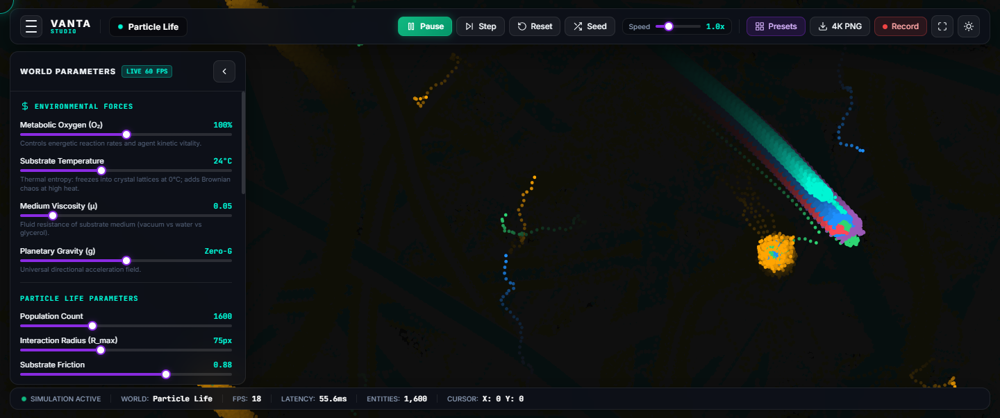
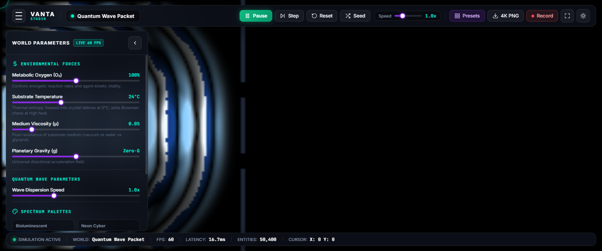
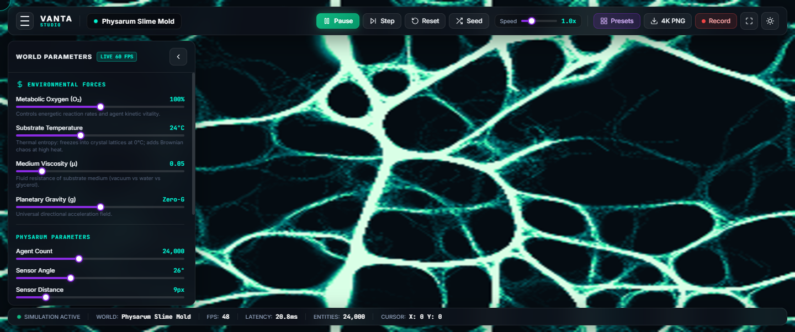
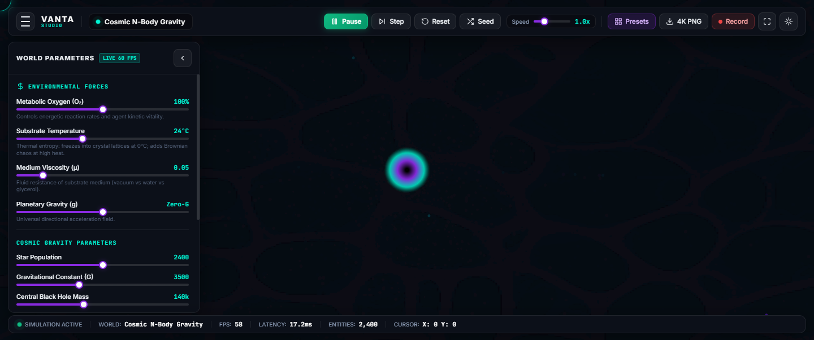
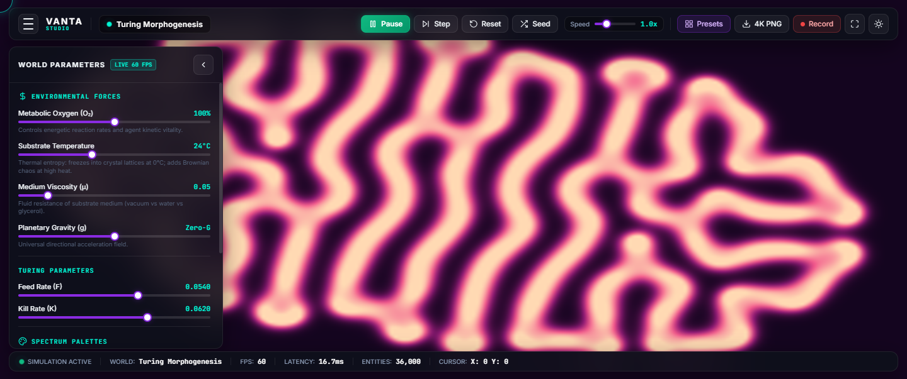
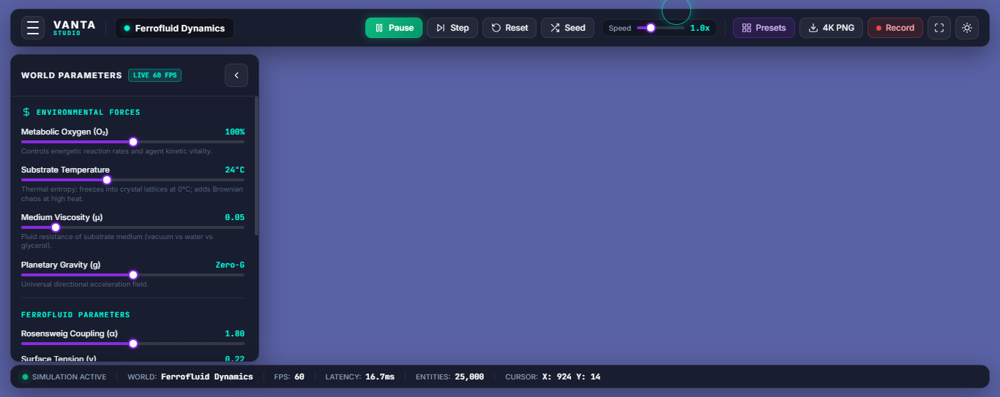
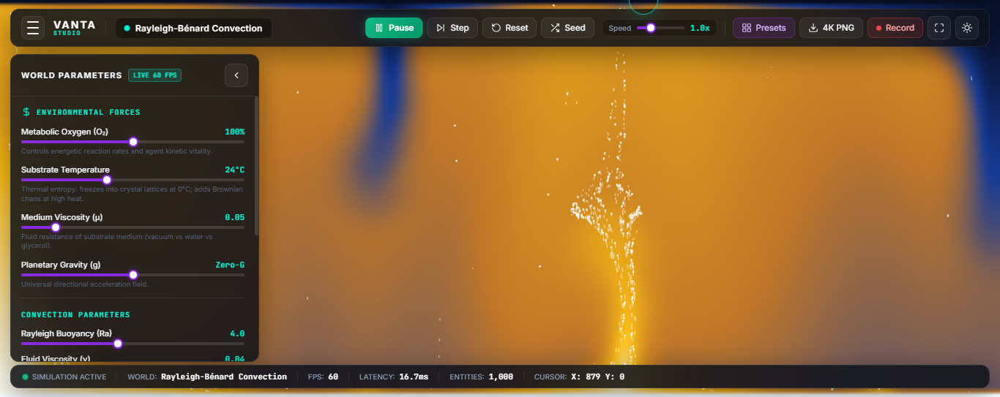
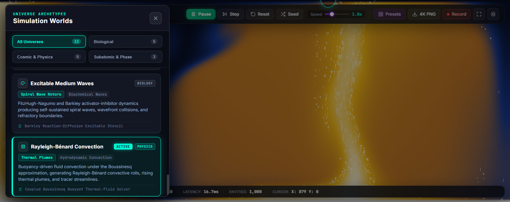

# استودیو حیات زایشی VANTA

استودیوی تعاملی دسکتاپ و وب برای کاوش در حیات مصنوعی، پویایی‌های غیرخطی و پدیده‌های نوظهور فیزیکی از طریق شبیه‌سازی بلادرنگ ریاضیاتی.

[](docs/screenshots/vanta-hero-overview.png)

---

## معرفی کلی

پروژه **VANTA** یک آزمایشگاه محاسباتی بلادرنگ است که معادلات دیفرانسیل با مشتقات جزئی (PDE)، دینامیک عامل‌های گسسته، فیزیک ذرات و خودکاره‌های سلولی پیوسته را در یک محیط منسجم گرد هم می‌آورد. به جای رندر کردن انیمیشن‌های از پیش محاسبه‌شده یا طرح‌های ایستا، تمامی الگوها در VANTA به صورت خودبه‌خودی و فریم‌به‌فریم از قوانین بنیادی ریاضی روی سخت‌افزار شما متولد می‌شوند.

از فرایند زیست‌زایی سلولی در سطح ذرات نامتقارن تا مارپیچ‌های کلان‌مقیاس خوشه‌های ستاره‌ای نسبیتی و تداخل بسته‌های موج مکانیک کوانتومی، VANTA این امکان را به شما می‌دهد تا مستقیماً به سیستم نیرو وارد کنید، پارامترها را تغییر دهید و شاهد پدیدار شدن نظم از دل هرج‌ومرج باشید.

### چرا VANTA ساخته شد؟
پیچیدگی‌های جهان طبیعی معمولاً از دل قوانینی شگفت‌انگیز و ساده سرچشمه می‌گیرند. آلن تورینگ نشان داد که چگونه نفوذ و واکنش متقابل دو ماده شیمیایی می‌تواند الگوهای پوست جانوران را ایجاد کند؛ کریگ رینولدز اثبات کرد که سه قانون هدایت محلی می‌تواند پرواز هزاران پرنده در یک دسته را بازآفرینی کند؛ و اندرکنش‌های نامتقارن میان ذرات می‌توانند دسته‌هایی خودتکثیرشونده و سلول‌مانند را بدون نیاز به کدهای ژنتیکی پدید آورند.

هدف از خلق VANTA، گردآوری این حوزه‌های بنیادین—فیزیک نظری، زیست‌شناسی محاسباتی، شیمی غیرخطی و کدنویسی خلاقانه—در یک استودیوی لمسی و بی‌درنگ بوده است.

---

## فهرست سیزده دنیای شبیه‌سازی

پروژه VANTA شامل ۱۳ موتور شبیه‌سازی کامل و کاملاً تعاملی در دسته‌های مورفوژنز زیستی، اخترفیزیک و آشوب ریاضیاتی است:

| جهان | کهن‌الگو | مدل ریاضی حاکم | رفتارهای نوظهور کلیدی |
| :--- | :--- | :--- | :--- |
| **حیات ذرات (Particle Life)** | زیست‌زایی نخستین | ماتریس نیروهای نامتقارن $F(r, M_{\alpha\beta})$ | تقسیم سلولی، تعقیب شکار و شکارچی، همزیستی خوشه‌ای |
| **کپک لجن (Physarum)** | شبکه آوندی هوشمند | کموتاکسی چندعاملی جونز و پخش فضایی | شبکه‌های بهینه انتقال زیستی، الگوریتم‌های درخت اشتاینر |
| **گرانش کیهانی N-Body** | اخترفیزیک نسبیتی | پتانسیل نیوتن-پلامر با درخت چهارگانه بارنز-هات | دیسک‌های برافزایشی، بازوهای کهکشانی کپلری، قلاب‌سنگ گرانشی |
| **ازدحام پرندگان (Boids)** | هوش جمعی | سه‌گانه رینولدز (جدایی، هم‌راستایی، پیوستگی) | امواج حرکتی تماشایی، فرار پویا از موانع، رفتار گله‌ای |
| **بسته موج کوانتومی** | مکانیک کوانتومی | معادله شرودینگر وابسته به زمان ($i\hbar \partial_t \psi = \hat{H}\psi$) | پراش دو شکاف، تداخل فاز، تونل‌زنی از سد پتانسیل |
| **رشد بلور دندریتی** | انجماد میدان-فاز | معادلات آنیزوتروپیک کوبایاشی | شاخه‌های شش‌گوشه بلورهای برف، دندریت‌های فرعی |
| **میدان پیچشی سیال (Curl Noise)** | آیرودینامیک تراکم‌ناپذیر | پتانسیل برداری بدون واگرایی ($\vec{v} = \nabla \times \vec{\Psi}$) | آشفتگی با پایستگی جرم، فیلامنت‌های گردابی، خطوط جریان سیال |
| **واکنش-پخش گری-اسکات** | مورفوژنز تورینگ | معادلات دیفرانسیل جزئی اتوکاتالیتیک مکعبی | لکه‌های خودتکثیرشونده میتوزی، الگوهای مارپیچی، سالیتون‌ها |
| **لنیا پیوسته (Lenia)** | خودکاره‌های سلولی پیوسته | کانولوشن میدان با هسته حلقوی $K * A$ و تابع رشد $G$ | ارگانیسم‌های لغزنده و تنفس‌کننده ارگانیک، سالیتون‌های پایدار |
| **فروسیال مغناطیسی** | هیدرودینامیک مغناطیسی | ناپایداری رزن‌سوایگ در اثر کشش سطحی و میدان قائم | شبکه‌های خودبه‌خودی سنبله‌های مغناطیسی شش‌ضلعی |
| **رشد فراکتالی (DLA)** | تجمع محدود به پخش | مدل تجمع فیزیکی ویتن-سندر با گام‌های براونی | ساختارهای درختی فراکتالی خودمشابه با بعد $D \approx 1.71$ |
| **محیط تحریک‌پذیر** | امواج غیرخطی شیمیایی | سیستم برانگیختگی-آرامش فیتزه‌یو-ناگومو | گرداب‌های موج مارپیچی چرخان، برخورد امواج، دم‌های بازدارنده |
| **همرفت حرارتی** | مکانیک سیالات | معادلات ناویر-استوکس با تقریب بوزینسک | سلول‌های چرخشی رایلی-بنارد، ستون‌های بالارونده گوشته |

---

## نگارخانه تصاویر واقعی

تصاویر زیر اسکرین‌شات‌های زنده و واقعی استخراج‌شده از نسخه در حال اجرای نرم‌افزار در رزولوشن ۱۴۴۰×۹۰۰ می‌باشند:

| تداخل بسته موج کوانتومی شرودینگر | شبکه جستجوی آوندی کپک لجن (Physarum) |
| :---: | :---: |
| [](docs/screenshots/vanta-quantum-wave.png) | [](docs/screenshots/vanta-physarum.png) |
| *شکافت بسته موج از میان سد دوشکاف و تشکیل طرح تداخل چگالی احتمال* | *شبکه‌سازی بیولوژیکی ارگانیسم تک‌سلولی جهت اتصال بهینه‌ترین مسیرها* |

| گرانش کیهانی چندجرمی (N-Body) | واکنش-پخش تورینگ (Gray-Scott) |
| :---: | :---: |
| [](docs/screenshots/vanta-cosmic-gravity.png) | [](docs/screenshots/vanta-reaction-diffusion.png) |
| *دیسک برافزایشی و خوشه‌های ستاره‌ای پیرامون تکینگی گرانشی* | *پدیداری لکه‌های شیمیایی خودتکثیرشونده و الگوهای پوستی تورینگ* |

| سنبله‌های ناپایداری فروسیال | همرفت گردابی حرارتی رایلی-بنارد |
| :---: | :---: |
| [](docs/screenshots/vanta-ferrofluid.png) | [](docs/screenshots/vanta-thermal-convection.png) |
| *تشکیل سنبله‌های متقارن سطحی تحت القای میدان مغناطیسی عمودی* | *پایستگی گردابه‌ها و انتقال شناوری حرارتی در معادله ناویر-استوکس* |

| کشوی انتخاب سیزده کهن‌الگوی جهان |
| :---: |
| [](docs/screenshots/vanta-worlds-drawer.png) |
| *سایدبار دسته‌بندی‌شده شامل کارت‌های اطلاعاتی، معادلات فیزیک و شمارنده بلادرنگ ذرات* |

---

## قابلیت‌های شاخص مهندسی

- **معماری دوگانه و مستقل (Dual-Target)**:
  - **استودیوی وب**: مبتنی بر جاوااسکریپت خالص و مدرن (ES6+)، بوم نقاشی Canvas 2D و WebGL بدون هیچ‌گونه وابستگی به کتابخانه‌های خارجی با نرخ ۶۰ فریم بر ثانیه.
  - **اپلیکیشن دسکتاپ Qt6**: توسعه‌یافته با PySide6 در پایتون با شتاب‌دهنده سخت‌افزاری OpenGL و موتور جایگزین نرم‌افزاری.
  - **لانچر اجرایی نیتیو**: فایل سبک ۶ کیلوبایتی (`VANTA.exe`) نوشته‌شده با سی‌شارپ برای اجرای مستقیم استودیو در حالت اختصاصی اپلیکیشن دسکتاپ.
- **فیزیک مستقیم نشانگر ماوس**:
  - کلیک چپ چاه گرانشی، بذر شیمیایی یا منبع حرارتی ایجاد می‌کند.
  - کلیک راست امواج ضربه‌ای با سرعت بالا برای پراکندگی ذرات و انحراف جبهه‌های موج ساطع می‌کند.
- **تله‌متری زنده و تابلوی پارامترها**:
  - پایش نرخ فریم (FPS)، تأخیر فریم به میلی‌ثانیه، شمارنده موجودیت‌ها و مختصات ماوس در HUD.
  - تنظیم بلادرنگ پارامترهای هر مدل فیزیکی با لغزنده‌های دقیق.
- **ضبط و صدور خروجی رسانه‌ای با کیفیت بالا**:
  - خروجی تصویر با وضوح بالا در قالب PNG با واترمارک زمان‌بندی‌شده.
  - ضبط ویدیوی روان 60FPS با کدک سخت‌افزاری WebM (VP9/VP8) به طور مستقیم از بوم شبیه‌سازی.
- **صفحه لودینگ و شروع اختصاصی (Bespoke Startup)**:
  - تجربه ۴٫۰ ثانیه‌ای آغازین همراه با پرده ذرات هارمونیک زنده، لوگوی اختصاصی وکتور معماری، فیلتر نویز سینمایی فیلم و شمارنده تله‌متری پیوسته.

---

## راهنمای اجرای سریع

### ۱. اجرای مستقیم در ویندوز (بدون نیاز به نصب)
فایل `VANTA.exe` موجود در ریشه پروژه را باز کنید تا استودیو در یک پنجره مستقل با ابعاد ۱۴۴۰×۹۲۰ بدون نیاز به نصب پایتون یا دستورات کنسول اجرا شود.  
(همچنین می‌توانید فایل `run.bat` یا `run.ps1` را اجرا کنید).

### ۲. اجرا در مرورگر (تمامی سیستم‌عامل‌ها)
مخزن را دانلود کرده و فایل `studio/index.html` را در هر مرورگر مدرنی باز کنید:
```bash
git clone https://github.com/P0O1N0/VANTA.git
cd VANTA
# باز کردن فایل در مرورگر:
start studio/index.html
```

### ۳. محیط توسعه پایتون و دسکتاپ PySide6
```bash
git clone https://github.com/P0O1N0/VANTA.git
cd VANTA

# اجرای اسکریپت راه‌اندازی خودکار
setup.bat

# یا راه‌اندازی دستی:
python -m venv .venv
.venv\Scripts\activate
pip install -r requirements.txt

# اجرای نرم‌افزار دسکتاپ
python -m vanta.main

# اجرای تست‌های خودکار
pytest
```

---

## کلیدهای میانبر کاربری

| کلید | عملکرد | توضیحات |
| :--- | :--- | :--- |
| **کلیک چپ + کشیدن** | **جذب / تزریق** | ایجاد چاه گرانش، تزریق بذر شیمیایی یا حرارتی |
| **کلیک راست + کشیدن** | **دفع / موج شوک** | پراکندگی ذرات و کنار زدن جریان‌ها |
| <kbd>Space</kbd> | **پخش / توقف** | توقف موقت بدون پاک شدن وضعیت شبیه‌سازی |
| <kbd>N</kbd> | **گام تک‌فریم** | پیشروی شبیه‌سازی دقیقاً به اندازه یک برش زمانی |
| <kbd>C</kbd> | **ریست** | بازنشانی جهان به وضعیت اولیه |
| <kbd>R</kbd> | **بذر تصادفی** | تصادفی‌سازی موقعیت‌ها و ماتریس برهم‌کنش‌ها |
| <kbd>M</kbd> / <kbd>Tab</kbd> | **کشوی جهان‌ها** | باز و بسته کردن منوی سایدبار انتخاب دنیاها |
| <kbd>P</kbd> | **پریست‌ها** | باز کردن کاتالوگ حالت‌های برگزیده پارامترها |
| <kbd>Z</kbd> | **حالت ذن (Zen)** | مخفی‌سازی کامل نوار ابزار و پنل‌ها برای نمایش تمام‌صفحه |
| <kbd>T</kbd> | **تغییر پوسته** | جابه‌جایی میان تم تاریک آبسیدین و روشن پلاتینیومی |

---

## مستندات جامع علمی و فنی

- [**مبانی علمی و معادلات دیفرانسیل (`docs/SCIENCE.md`)**](docs/SCIENCE.md) — استخراج کامل فرمول‌ها، استنسیل‌های عددی و فیزیک تمام ۱۳ موتور.
- [**معماری نرم‌افزار (`docs/ARCHITECTURE.md`)**](docs/ARCHITECTURE.md) — نمودارهای توالی، ماشین وضعیت، جریان داده‌ها و ساختار حافظه.
- [**راهنمای کاربر (`docs/USER_GUIDE.md`)**](docs/USER_GUIDE.md) — کتابچه تعاملی ابزارها، کنترل‌ها و روش ذخیره ویدیوها.
- [**مهندسی کارایی و بهینه‌سازی (`docs/PERFORMANCE.md`)**](docs/PERFORMANCE.md) — معماری شبکه‌بندی فضایی، آرایه‌های نوع‌دار و بنچمارک ۶۰ فریم.
- [**کتابچه راهنمای توسعه‌دهنده (`docs/DEVELOPMENT.md`)**](docs/DEVELOPMENT.md) — راهنمای افزودن شبیه‌سازی‌های جدید و اجرای تست‌ها.
- [**مرور پژوهش‌ها و مراجع (`docs/RESEARCH_REVIEW.md`)**](docs/RESEARCH_REVIEW.md) — کتاب‌شناسی مقالات مرجع (تورینگ، رینولدز، جونز، چان و غیره).

---

## سازنده و اطلاعات تماس

طراحی و مهندسی پروژه **VANTA** توسط:

**P O N**  
- **گیت‌هاب:** [@P0O1N0](https://github.com/P0O1N0)  
- **تلگرام:** [@P0O1N0](https://t.me/P0O1N0)  
- **آدرس مخزن:** [github.com/P0O1N0/VANTA](https://github.com/P0O1N0/VANTA)

---

## مجوز انتشار (License)

این پروژه تحت مجوز متن‌باز **MIT License** منتشر شده است. برای مطالعه جزئیات به فایل [`LICENSE`](LICENSE) مراجعه نمایید.
