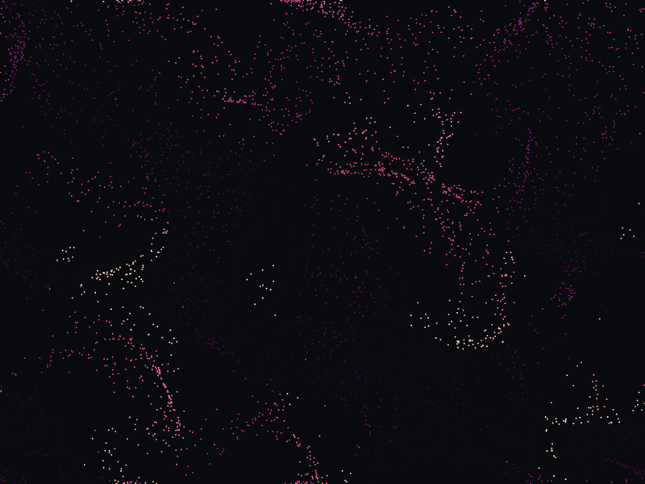
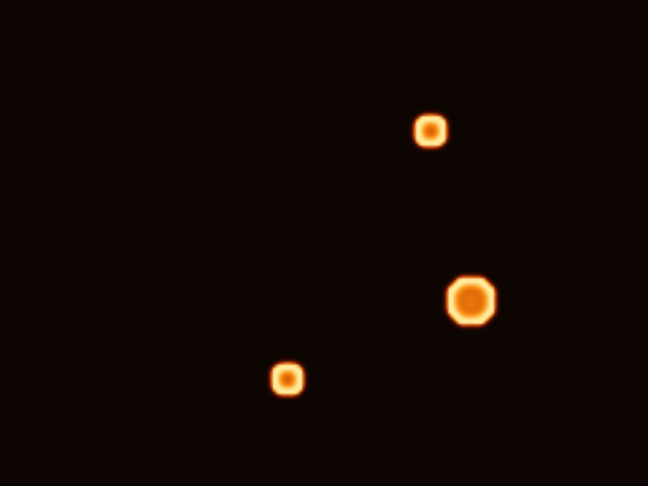

# استودیوی وانتا (VANTA — Generative Life Studio)

[](LICENSE)
[](https://www.python.org/)
[-green)](https://www.qt.io/)
[](https://numpy.org/)
[](#نیازمندی‌های-سیستم)

**وانتا (VANTA)** یک استودیوی دسکتاپ آفلاین، یکپارچه و مدرن برای خلق هنر مولد (Generative Art)، شبیه‌سازی حیات مصنوعی (Artificial Life) و پدیده‌های ریاضی نوظهور است. این نرم‌افزار رایانه شما را به دنیایی زنده و تعاملی بدل می‌کند که الگوهای بصری آن نه انیمیشن‌های از پیش ضبط‌شده، بلکه برآمده از قوانین محاسباتی دقیق و قوانین فیزیکی و زیستی هستند.

این برنامه به گونه‌ای مهندسی شده که کاملاً **آفلاین، بدون نیاز به اینترنت، بدون نیاز به ثبت‌نام یا اکانت، بدون نیاز به اشتراک یا کلیدهای API ابری** کار کند.

---

## گالری بصری شبیه‌سازها

| حیات ذرات (اکوسیستم چندگونه‌ای) | فیزاروم / کپک مخاطی (شبکه زیستی) |
| :---: | :---: |
|  |  |
| **میدان جریان نویز کرل بدون دیورژانس** | **واکنش-پخش گری-اسکات (مورفوژنز)** |
|  |  |

---

## قابلیت‌های کلیدی

### ۱. چهار موتور شبیه‌سازی واقعی و مستقل
- **موتور الف — حیات ذرات (Particle Life):** شبیه‌سازی فضای پیوسته ذرات با چند گونه متمایز. دارای ماتریس کامل برهم‌کنش جاذبه و دافعه بین گونه‌ها، انکسار فاصله، فیزیک مرزهای حلقوی (Torus) و بازتابی، و پارتیشن‌بندی شبکه‌ای برای ارتقای بازدهی و سرعت.
- **موتور ب — فیزاروم / کپک مخاطی (Physarum):** شبیه‌سازی عامل‌محور پدیده خودسازمان‌دهنده زیستی بر اساس مدل حسگری-حرکتی جف جونز (Jeff Jones). عامل‌ها سیگنال شیمیایی را با ۳ حسگر ارزیابی کرده، مسیر خود را تنظیم و با ترشح و پخش شیمیایی شبکه‌های رگ‌مانند ارگانیک می‌سازند.
- **موتور ج — میدان جریان (Flow Field):** میدان برداری نویز کرل بدون دیورژانس با حرکت روان ذرات، طول عمر متغیر، پالت‌های رنگی منطبق با بردار سرعت و گرداب‌های تعاملی با کلیک ماوس.
- **موتور د — واکنش-پخش گری-اسکات (Reaction-Diffusion):** حل معادلات دیفرانسیل پاره‌ای برای مدل‌سازی ساختارهای طبیعی نظیر مرجان‌ها، میتوز سلولی، سالیتون‌های جهنده و خطوط پوست جانوران با استفاده از عملگر لاپلاسین ۹ نقطه‌ای متقارن.

### ۲. پایپ‌لاین رندرینگ دوگانه (Dual Pipeline)
- **موتور رندر OpenGL سخت‌افزاری:** ادغام مستقیم با `QOpenGLWidget` و بچینگ نقاط برای دستیابی به بالاترین نرخ فریم روی کارت‌های گرافیک مجزا یا یکپارچه.
- **موتور رندر نرم‌افزاری CPU با QPainter:** اجرای صددرصد پایدار با بافرهای `QImage` نگاشت‌شده در حافظه، که تضمین می‌کند نرم‌افزار حتی روی قدیمی‌ترین پردازنده‌ها یا ماشین‌های مجازی بدون هیچ کرشی اجرا شود.
- **پالت‌های رنگی جذاب:** شامل نئون سایبر، بیولومینسنس، اخگر کهربایی، مخمل طیفی، زمرد سمی و مونوکروم مینیمال.

### ۳. رابط کاربری مدرن و بومی‌سازی دوزبانه
- **پشتیبانی کامل از زبان فارسی (راست‌چین RTL):** چیدمان کاملاً آینه‌ای و طبیعی با فونت خوانا و استاندارد **وزیرمتن (Vazirmatn)**.
- **پشتیبانی کامل از زبان انگلیسی (چپ‌چین LTR):** با تایپوگرافی مدرن Inter / Segoe UI.
- **تغییر زنده زبان و تم (تاریک/روشن):** بدون نیاز به راه‌اندازی مجدد برنامه و بدون از دست رفتن وضعیت شبیه‌سازی.
- **ویرایشگر ماتریس برهم‌کنش گونه‌ها:** کنترل سطح مستقیم برای تغییر بلادرنگ ضرایب جاذبه و دافعه بین ذرات.
- **گالری الگوهای آماده (Preset Gallery):** دسته‌بندی‌شده در شاخه‌های کیهانی، زیستی، دینامیک سیالات و ریاضیات انتزاعی با قابلیت فیلتر و جستجوی آنی.

### ۴. ذخیره‌سازی محلی و خروجی باکیفیت
- **پایگاه داده محلی SQLite:** ذخیره تنظیمات، تاریخچه پروژه‌ها و پریست‌های سفارشی کاربر با مکانیزم ایمن WAL.
- **فرمت پروژه اختصاصی `.vanta`:** فایل‌های استاندارد و امن JSON به همراه ذخیره‌سازی اتمیک (Atomic Write) جهت جلوگیری از خراب شدن فایل‌ها در قطعی برق یا کرش.
- **خروجی تصویر با وضوح بالا (4K و Full HD):** ثبت تصاویر شفاف و باکیفیت از بوم شبیه‌سازی برای کارهای گرافیکی و والپیپر.
- **خروجی توالی فریم‌ها و ویدیو:** خروجی دقیق فریم‌به‌فریم با تایم‌استپ کنترل‌شده به همراه یکپارچگی خودکار با FFmpeg.

---

## نیازمندی‌های سیستم

- **سیستم‌عامل:** ویندوز ۱۰ یا ۱۱ (۶۴ بیتی)، لینوکس (اوبونتو ۲۲.۰۴ به بالا) یا مک (نسخه ۱۲ به بالا).
- **پردازنده:** ۴ هسته‌ای ۲.۰ گیگاهرتز به بالا (قابل اجرا روی Core i5 نسل ۴ به بعد / AMD Ryzen 3).
- **حافظه رم (RAM):** حداقل ۸ گیگابایت (دارای پروفایل عملکردی **Lite Mode** برای سخت‌افزارهای ضعیف‌تر).
- **گرافیک:** پشتیبانی از OpenGL 2.1+ یا استفاده از رندر نرم‌افزاری پردازنده.
- **پایتون:** نسخه ۳.۱۰ تا ۳.۱۲ (نسخه پیشنهادی: ۳.۱۱.۹).

---

## راهنمای نصب و راه‌اندازی سریع

### اجرای سریع در ویندوز
کافی است مخزن را دانلود کرده و فایل `run.bat` را دو بار کلیک کنید یا در پاورشل دستور زیر را اجرا نمایید:
```powershell
.\run.ps1
```
*(در اولین اجرا، اسکریپت به طور خودکار محیط مجازی ایزوله `.venv` را ساخته، بسته‌های مورد نیاز را نصب کرده و نرم‌افزار را اجرا می‌کند.)*

### راه‌اندازی دستی با پایتون
```bash
# ۱. کلون مخزن
git clone https://github.com/P0O1N0/VANTA.git
cd VANTA

# ۲. ساخت و فعال‌سازی محیط مجازی
python -m venv .venv
# در ویندوز:
.venv\Scripts\activate
# در لینوکس/مک:
source .venv/bin/activate

# ۳. نصب بسته‌های پیش‌نیاز
pip install -r requirements.txt

# ۴. اجرای برنامه
python -m vanta.main
```

---

## کلیدهای میانبر و کنترل‌ها

| عملکرد | کلید میانبر / کنترل | توضیحات |
| :--- | :--- | :--- |
| **اجرا / توقف** | `Space` / دکمه نوار بالا | آغاز یا متوقف‌سازی تکامل شبیه‌سازی |
| **یک گام به جلو** | `S` / دکمه نوار بالا | پیشروی شبیه‌سازی به اندازه یک گام محاسباتی |
| **بازنشانی** | `R` / دکمه نوار بالا | بازگشت شبیه‌سازی به شرایط اولیه |
| **تمام صفحه** | `F11` / `Esc` | تغییر وضعیت به حالت تمام صفحه بدون حاشیه |
| **خروجی‌گیری** | `E` / دکمه نوار بالا | باز کردن پنجره ذخیره تصویر یا ویدیو |
| **تعامل با کلیک چپ** | کلیک و درگ ماوس | جذب ذرات / ایجاد گرداب / تزریق ماده اولیه |
| **تعامل با کلیک راست**| کلیک و درگ ماوس | دفع ذرات / پاکسازی محدوده |
| **تغییر سرعت** | اسلایدر نوار بالا | تنظیم سرعت محاسبات از ۰.۲x تا ۳.۰x |

---

## نتایج بنچمارک شبیه‌سازی

تست‌شده روی لپ‌تاپ اداری مرجع ویندوز ۱۰ (پردازنده ۸ هسته‌ای اینتل، ۸ گیگابایت رم، گرافیک یکپارچه):

| موتور شبیه‌سازی | تعداد موجودیت‌ها / ابعاد | نرخ به‌روزرسانی (UPS) | تاخیر گام (میلی‌ثانیه) | نرخ فریم هدف |
| :--- | :--- | :--- | :--- | :--- |
| **میدان جریان (Flow Field)** | ۴,۰۰۰ ذره | **۹۶۱.۸ گام در ثانیه** | **۱.۰۴ میلی‌ثانیه** | ۶۰ فریم |
| **فیزاروم (Physarum)** | ۴,۰۰۰ عامل | **۲۰۳.۹ گام در ثانیه** | **۴.۹۱ میلی‌ثانیه** | ۶۰ فریم |
| **واکنش-پخش (Reaction-Diff)** | ۴۳,۲۰۰ سلول | **۶۹.۸ گام در ثانیه** | **۱۴.۳۳ میلی‌ثانیه** | ۶۰ فریم |
| **حیات ذرات (Particle Life)** | ۱,۵۰۰ ذره | **۳۴.۰ گام در ثانیه** | **۲۹.۴۴ میلی‌ثانیه** | ۳۰ تا ۶۰ فریم |

جهت اجرای بنچمارک روی رایانه خود:
```bash
python scripts/benchmark.py --duration 2.0
```

---

## آزمون‌های خودکار (Automated Tests)

استودیو وانتا شامل ۲۱ آزمون جامع است که صحت محاسبات ریاضی، پایداری عددی، بازتولیدپذیری، ذخیره‌سازی محلی و اجرای رابط کاربری را ارزیابی می‌کنند:

```bash
# اجرای تمامی آزمون‌ها
pytest -v
```

---

## ساخت نسخه مستقل ویندوز (Executable)

برای ساخت فایل اجرایی مستقل بدون نیاز به نصب پایتون در رایانه مقصد:
```powershell
.\scripts\build_windows.ps1
```
فایل خروجی در مسیر `dist/VANTA/VANTA.exe` ایجاد خواهد شد.

---

## مالکیت و راه‌های ارتباطی

**استودیوی حیات مولد وانتا (VANTA — Generative Life Studio)**  
- **طراح و توسعه‌دهنده:** P O N  
- **تلگرام:** [@P0O1N0](https://t.me/P0O1N0)  
- **گیت‌هاب:** [github.com/P0O1N0](https://github.com/P0O1N0)  
- **آدرس مخزن:** [https://github.com/P0O1N0/VANTA](https://github.com/P0O1N0/VANTA)

---

## مجوز (License)

این پروژه تحت مجوز متن‌باز **MIT License** منتشر شده است. متن کامل مجوز در فایل [LICENSE](LICENSE) در دسترس است.
