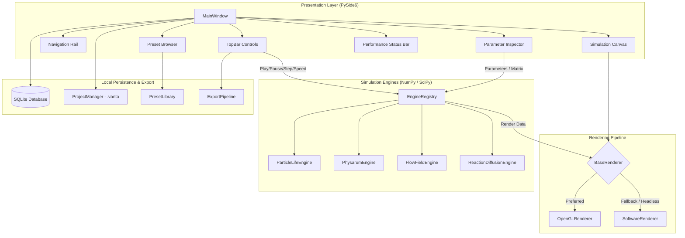

# VANTA — System Architecture & Design Specification

**Document Version:** 1.0.0  
**Project:** VANTA — Generative Life Studio  
**Target Platform:** Windows 10/11 Desktop (with portable Linux and macOS support)

---

## 1. System Overview

VANTA is engineered as a modular, offline-first generative simulation studio. Its architecture strictly separates:
1. **Simulation Domain:** Mathematical and numerical evolution of particle/agent/field states.
2. **Rendering Domain:** Hardware-accelerated OpenGL and software QPainter rasterization pipelines.
3. **Application Domain:** Local SQLite persistence, project `.vanta` serialization, preset management, and export.
4. **Presentation Domain:** PySide6 user interface, responsive layout, theme tokens, and bilingual (English LTR / Persian RTL) localization.



---

## 2. Directory and Module Organization

```
src/vanta/
├── __init__.py                 # Package version and metadata
├── main.py                     # CLI and application startup entrypoint
├── app.py                      # VantaApplication runtime lifecycle coordinator
├── config/
│   ├── __init__.py
│   └── settings.py             # Global constants, paths, default parameters
├── core/
│   ├── __init__.py
│   ├── base_engine.py          # Abstract BaseEngine contract
│   ├── engine_registry.py      # Engine catalog and factory
│   └── engines/
│       ├── __init__.py
│       ├── particle_life.py    # Multi-species continuous particle life
│       ├── physarum.py         # Slime mold agent sensory-motor system
│       ├── flow_field.py       # Curl noise procedural vector field
│       └── reaction_diffusion.py # Gray-Scott 2D concentration dynamics
├── rendering/
│   ├── __init__.py
│   ├── base.py                 # Abstract BaseRenderer interface
│   ├── opengl_renderer.py      # QOpenGLWidget shader/point batch renderer
│   ├── software_renderer.py    # QPainter software fallback rasterizer
│   └── palettes.py             # Scientific and artistic color palettes
├── ui/
│   ├── __init__.py
│   ├── main_window.py          # Main studio workspace window
│   ├── canvas.py               # Viewport widget hosting renderer
│   ├── components/
│   │   ├── __init__.py
│   │   ├── top_bar.py          # Header controls (play/pause/theme/i18n/export)
│   │   ├── navigation_rail.py  # Left engine selector & drawer
│   │   ├── inspector.py        # Dynamic parameter controls & sliders
│   │   ├── matrix_editor.py    # Interactive species interaction matrix
│   │   ├── preset_browser.py   # Visual preset gallery with filter/search
│   │   ├── hud_overlay.py      # Real-time metrics and HUD
│   │   └── toast.py            # Floating notification banners
│   ├── dialogs/
│   │   ├── __init__.py
│   │   ├── about_dialog.py     # Attribution and system information
│   │   ├── export_dialog.py    # Still and video export settings
│   │   └── settings_dialog.py  # Quality and application settings
│   └── themes/
│       ├── __init__.py
│       ├── tokens.py           # Color palette, spacing, and font constants
│       └── style.py            # QSS stylesheet generators (Dark & Light)
├── storage/
│   ├── __init__.py
│   ├── database.py             # SQLite manager with WAL mode
│   └── migrations.py           # Incremental schema migration engine
├── projects/
│   ├── __init__.py
│   └── project_manager.py      # Safe .vanta JSON serialization & validation
├── presets/
│   ├── __init__.py
│   ├── library.py              # Curated factory presets across 4 engines
│   └── preset_manager.py       # Custom user preset storage and management
├── export/
│   ├── __init__.py
│   ├── image_exporter.py       # Lossless PNG & high-res renderer
│   └── video_exporter.py       # Sequence and MP4 frame dispatcher
├── localization/
│   ├── __init__.py
│   ├── i18n.py                 # Internationalization manager
│   ├── en.py                   # English language dictionary
│   └── fa.py                   # Persian (Farsi) language dictionary
└── utilities/
    ├── __init__.py
    ├── platform_detector.py    # Hardware, GPU, RAM, and OS inspection
    ├── logger.py               # Rotating file and console logger
    └── noise.py                # Fast 2D Perlin / Simplex / curl noise
```

---

## 3. Core Engine Lifecycle Contract (`BaseEngine`)

Every simulation engine inherits from `BaseEngine` and adheres to a strict contract:

```python
class BaseEngine(ABC):
    @abstractmethod
    def initialize(self, width: int, height: int, seed: int | None = None) -> None:
        """Initialize or reseed simulation buffers."""
        pass

    @abstractmethod
    def step(self, dt: float) -> None:
        """Advance the simulation state by a fixed timestep dt."""
        pass

    @abstractmethod
    def reset(self) -> None:
        """Reset the simulation back to initial conditions."""
        pass

    @abstractmethod
    def get_render_data(self) -> RenderData:
        """Return renderable primitives (particles, vectors, or field texture)."""
        pass

    @abstractmethod
    def get_parameters(self) -> dict[str, Any]:
        """Return current dictionary of configurable parameters."""
        pass

    @abstractmethod
    def set_parameters(self, params: dict[str, Any]) -> None:
        """Validate and apply updated parameters."""
        pass

    @abstractmethod
    def interact(self, x: float, y: float, button: int, mode: str) -> None:
        """Handle canvas mouse clicks or drag gestures."""
        pass
```

### Determinism and Reproducibility
Every engine uses NumPy's modern `np.random.Generator(np.random.PCG64(seed))`. When initialized with the exact same seed and parameters, every engine generates identical initial conditions and evolves identically under fixed timesteps ($\Delta t$).

---

## 4. Dual Rendering Architecture

Rendering is decoupled from simulation state via `RenderData`:
- `RenderData.mode`: `'particles'` (positions, colors, radii), `'field'` (2D scalar/RGB array for continuous diffusion/density), or `'hybrid'`.
- `OpenGLRenderer`: Inherits from `QOpenGLWidget`. Utilizes point sprites or textured quads for high frame rates on dedicated or integrated GPUs.
- `SoftwareRenderer`: Inherits from `QWidget`. Employs `QPainter` drawing directly onto memory-mapped `QImage` buffers, guaranteeing universal fallback on any CPU or virtualized environment.

---

## 5. Storage and Serialization

### SQLite Database (`vanta.db`)
- Created at `%LOCALAPPDATA%\VANTA\vanta.db` on Windows (with portable fallbacks).
- Stores application preferences (theme, language, quality profile, last window geometry).
- Tracks recent projects, custom presets, and export history.
- Protected against corruption via SQLite WAL mode and atomic transactions.

### Project Files (`.vanta`)
- Encoded as UTF-8 JSON.
- Contains metadata, engine ID, random seed, parameter dict, color palette, and optional state snapshot.
- Deserialization is protected against arbitrary code execution (no `pickle` or `eval`).

---

## 6. Bilingual Localization & RTL Layout

- Supports **English (LTR)** and **Persian (RTL)**.
- Switching language changes:
  1. Window layout direction via `QApplication.setLayoutDirection()`.
  2. Dynamic re-translation of all user-facing strings, buttons, tooltips, dialogs, and HUD indicators.
- Persian typography utilizes the bundled/system Vazirmatn font for maximum legibility.

---

## 7. Performance & Quality Profiles

VANTA defines three explicit quality profiles:
1. **Lite:** Lower particle limits (e.g. 500-1000), simpler rendering, reduced trail persistence. Ideal for low-spec dual/quad-core laptops with 8 GB RAM.
2. **Balanced (Default):** Moderate agent density (1500-2500), smooth trails, optimized spatial hashing. Stable 60 FPS on typical machines.
3. **High:** Maximum density (3000-5000+), high-resolution trail fields, richest color blending.
- **Adaptive Quality:** If FPS drops below 25 for sustained frames, VANTA automatically dampens visual effects to maintain responsive interaction.
