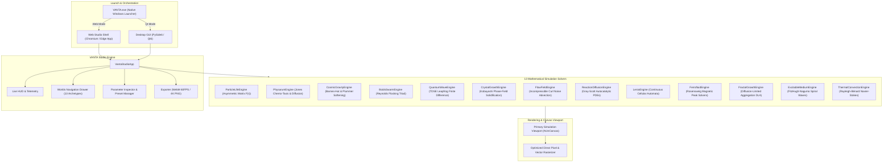
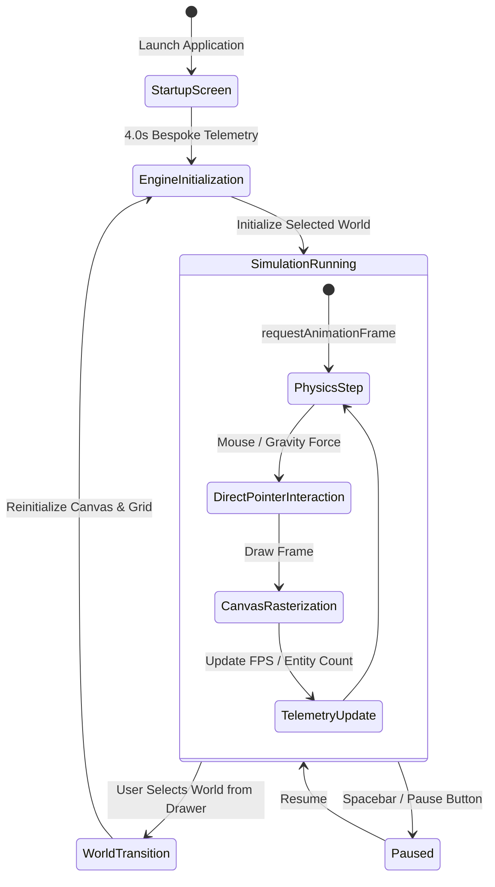

# VANTA — System Architecture & Engineering Design

**Project:** VANTA — Generative Life Studio  
**Author:** P O N ([@P0O1N0](https://github.com/P0O1N0))  
**Repository:** [github.com/P0O1N0/VANTA](https://github.com/P0O1N0/VANTA)  
**Supported Runtimes:** Windows 10/11 Desktop, PySide6 Qt6, Modern Web Browsers (Chrome / Edge / Firefox)

---

## 1. Architectural Philosophy

VANTA is architected as an offline-first, dual-target generative life and physical simulation studio. Its engineering design strictly separates:
1. **Mathematical Simulation Core:** Discrete particle systems, partial differential equation solvers, lattice automata, and agent-based spatial models.
2. **Rendering & Compositing Pipeline:** High-performance Canvas 2D / WebGL rasterization with pixel-manipulation buffers and QPainter desktop fallbacks.
3. **Control & Parameter Dispatch:** Dynamic bi-directional parameter bus supporting live continuous adjustment, state serialization, and preset loading.
4. **Presentation & Studio Shell:** Modernist dark-mode UI with floating HUD telemetry, responsive worlds drawer, and hardware-accelerated WebM video and PNG snapshot exporters.



---

## 2. Dual-Target Runtime Architecture

### A. Web Studio (`studio/index.html`, `studio/js/bundle.js`, `studio/css/style.css`)
- **Engine Container:** Zero-dependency vanilla ES6+ architecture executing at native browser speed.
- **Rendering Loop:** Synchronized with `requestAnimationFrame` maintaining smooth 60 FPS update cycles.
- **Pixel Pipeline:** Hybrid vector drawing (paths, glow arcs, trajectories) and direct `ImageData` typed array manipulation (`Uint32Array` buffers) for cellular and field PDE simulations.
- **Zero Latency:** No cloud dependencies, no tracking scripts, completely functional offline and portable.

### B. Desktop Qt6 App (`src/vanta/`, `vanta.main`)
- **Framework:** PySide6 (Qt 6.6+) with decoupled QThread simulation workers.
- **Packaging:** Standalone executable buildable with PyInstaller or launchable directly via `.venv`.
- **Hardware Acceleration:** Native OpenGL widget rendering with QPainter fallback.

### C. Native Launcher (`VANTA.exe`)
- Ultra-lightweight 6KB compiled C# launcher (`scripts/Launcher.cs`) targeting `.NET Framework 4.0+`.
- Seamlessly resolves local Edge or Chrome installations to launch the studio in dedicated `--app` window mode (`1440x920`), offering a desktop-native application feel.

---

## 3. Simulation Core & Engine Lifecycle

Every simulation engine implements a uniform contract:
```typescript
interface SimulationEngine {
  canvas: HTMLCanvasElement;
  ctx: CanvasRenderingContext2D;
  init(): void;
  update(dt: number, mouse: MouseState): void;
  render(): void;
  reset(): void;
  applyPreset(presetId: string): void;
  setParam(key: string, value: number): void;
}
```

### Lifecycle State Machine


---

## 4. Parameter Dispatch & State Management

Parameters are exposed declaratively through world manifests. When a user selects a world:
1. `renderInspector()` queries the active engine for its customizable parameters, ranges, and current values.
2. Sliders and toggle controls are generated dynamically with real-time bidirectional binding.
3. User interactions (e.g. adjusting Rayleigh number $Ra$, Gray-Scott feed rate $F$, or Particle Life friction $\gamma$) mutate the engine state directly without garbage-collection overhead.
4. Presets are stored as JSON configurations that re-seed state arrays and reset parameter groups deterministically.

---

## 5. Media & Export Pipeline

VANTA includes high-resolution export pipelines operating directly in the browser:
- **PNG Snapshots:** Renders the simulation viewport to an offscreen canvas at device pixel ratio, applying watermark telemetry and downloading timestamped PNGs (`VANTA_<world>_<timestamp>.png`).
- **WebM Video Recorder:** Leverages the native `MediaStream` and `MediaRecorder` API (`canvas.captureStream(60)`), recording smooth VP9 / VP8 60 FPS video clips directly to disk.

---

## 6. Directory Layout & Module Structure

```text
VANTA/
├── VANTA.exe               # 6KB native C# application launcher
├── pyproject.toml          # Python project metadata & dependencies
├── requirements.txt        # Pinned Python package dependencies
├── setup.bat / setup.ps1   # Automated Windows environment setup
├── run.bat / run.ps1       # One-click startup scripts
├── LICENSE                 # MIT License (Author: P O N)
├── studio/                 # High-performance generative studio
│   ├── index.html          # Clean HTML5 studio shell & splash screen
│   ├── css/style.css       # Obsidian luxury theme & responsive layout
│   └── js/bundle.js        # Complete 13 simulation engines & studio app
├── src/vanta/              # Python PySide6 desktop application
│   ├── app.py              # Main application coordinator
│   ├── main.py             # Python entry point
│   ├── config/             # System settings & author metadata
│   ├── core/engines/       # Python simulation engines
│   ├── rendering/          # OpenGL & software renderers
│   └── ui/                 # Qt widgets, HUD, and splash screen
├── tests/                  # Test suite
│   ├── smoke/              # Startup and import checks
│   └── unit/               # Engine and widget unit tests (pytest)
├── scripts/                # Verification, build, and launcher sources
│   ├── Launcher.cs         # C# source for VANTA.exe
│   └── verify_bundle.py    # Syntax, bracket, and engine integrity check
└── docs/                   # Documentation & research suite
    ├── ARCHITECTURE.md     # Software architecture (this document)
    ├── SCIENCE.md          # Mathematical formulas and physical derivations
    ├── INSTALLATION.md     # Step-by-step setup guide
    ├── USER_GUIDE.md       # Interactive controls & user manual
    ├── PERFORMANCE.md      # Performance benchmarks & optimization
    ├── DEVELOPMENT.md      # Developer guide & engine authoring
    ├── RESEARCH_REVIEW.md  # Scientific papers & foundational literature
    └── screenshots/        # High-resolution genuine captures
```
